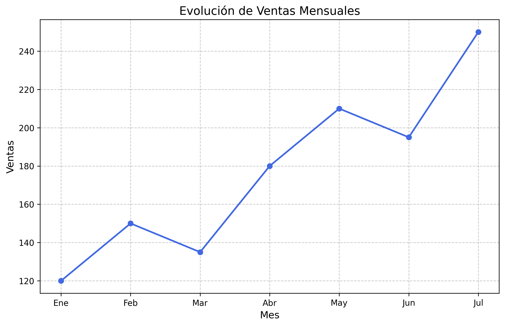

# Customer Churn Analysis
# Título	Título principal
## Subtítulo	Subtítulo
**Texto**	Texto en negrita
*Texto*	Texto en cursiva
- Elemento	Lista
[Texto](URL)	Enlace
	Imagen
`código`	Código en línea


## 1. Project Overview

This project focuses on analyzing customer data to identify patterns and develop predictive models for customer churn.

The main objective is to explore the dataset, understand the factors associated with customer churn, and evaluate different machine learning algorithms.

## 2. Objectives

- Perform exploratory data analysis (EDA).
- Identify relevant variables and patterns.
- Prepare and clean the dataset.
- Train and evaluate machine learning models.
- Compare model performance.

## 3. Technologies Used

- Python
- Pandas
- NumPy
- Matplotlib
- Scikit-learn
- Jupyter Notebook

## 4. Repository Structure

```text
customer-churn-analysis/
│
├── data/
├── notebooks/
├── src/
├── images/
├── README.md
└── requirements.txt
```

## 5. Dataset

Description of the dataset, its source, number of observations, variables, and relevant characteristics.

Dataset source: [Add dataset link here]

## 6. Exploratory Data Analysis

Description of the main exploratory analysis performed.

### Correlation Matrix



### Data Distributions


## 7. Machine Learning Models

Models evaluated:

- Logistic Regression
- Decision Tree
- Random Forest

Describe the methodology, preprocessing, and evaluation strategy.

## 8. Results

Present the evaluation metrics and compare model performance.

| Model | Accuracy | Precision | Recall | F1-score |
|---|---|---|---|---|
| Logistic Regression | TBD | TBD | TBD | TBD |
| Decision Tree | TBD | TBD | TBD | TBD |
| Random Forest | TBD | TBD | TBD | TBD |

## 9. Conclusions

Summarize the main findings, best-performing model, limitations, and possible improvements.

## 10. How to Run the Project

1. Clone or download this repository.
2. Install the required dependencies:

```bash
pip install -r requirements.txt
```

3. Open Jupyter Notebook.
4. Navigate to the `notebooks/` folder.
5. Run the notebook.

## 11. Author

Your Name

Data Science Student | Universidad Técnica Federico Santa María

[LinkedIn](YOUR_LINKEDIN_URL) | [GitHub](YOUR_GITHUB_URL)
